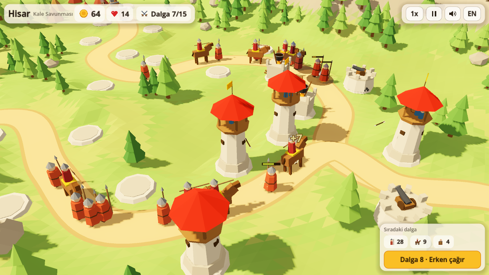
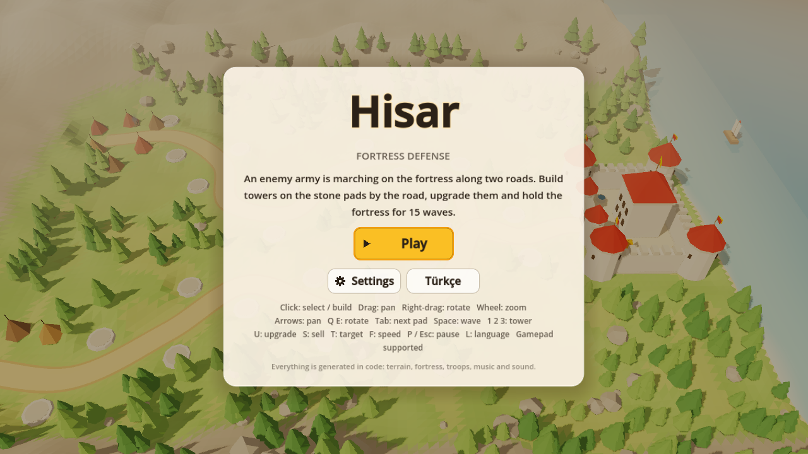
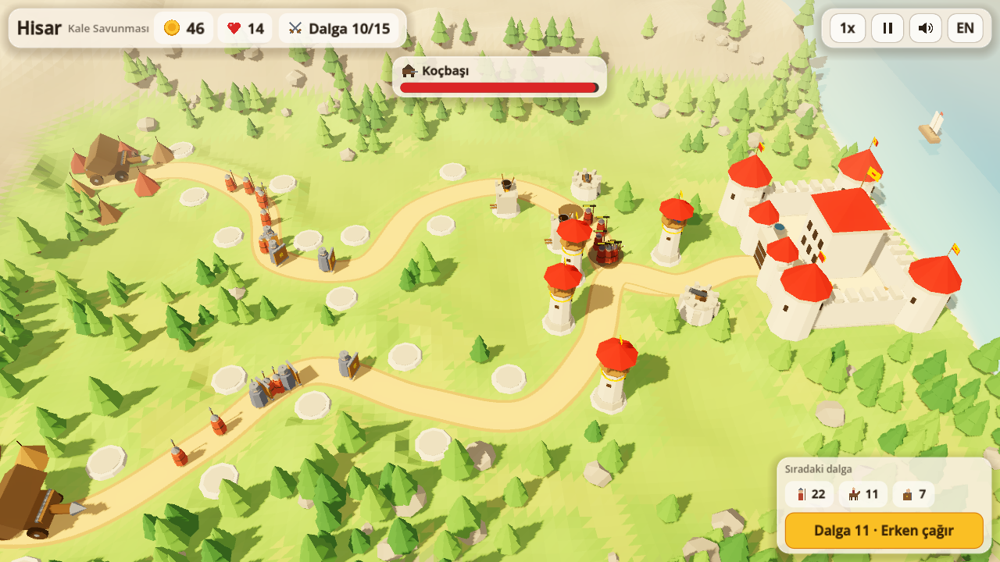
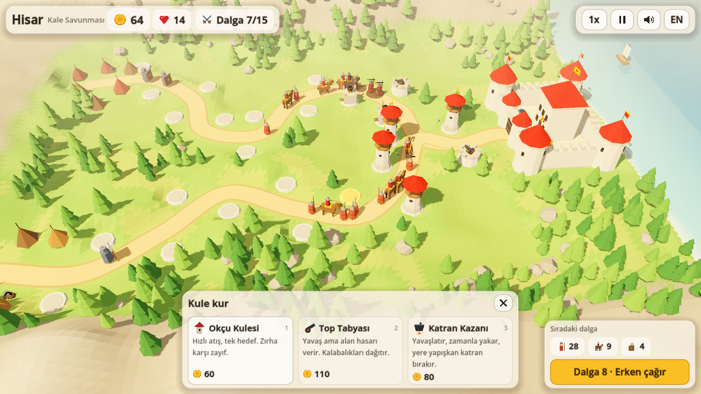
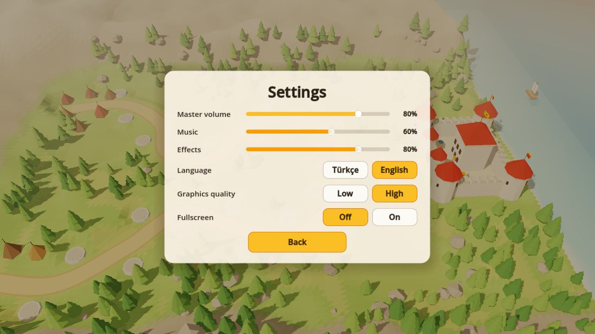
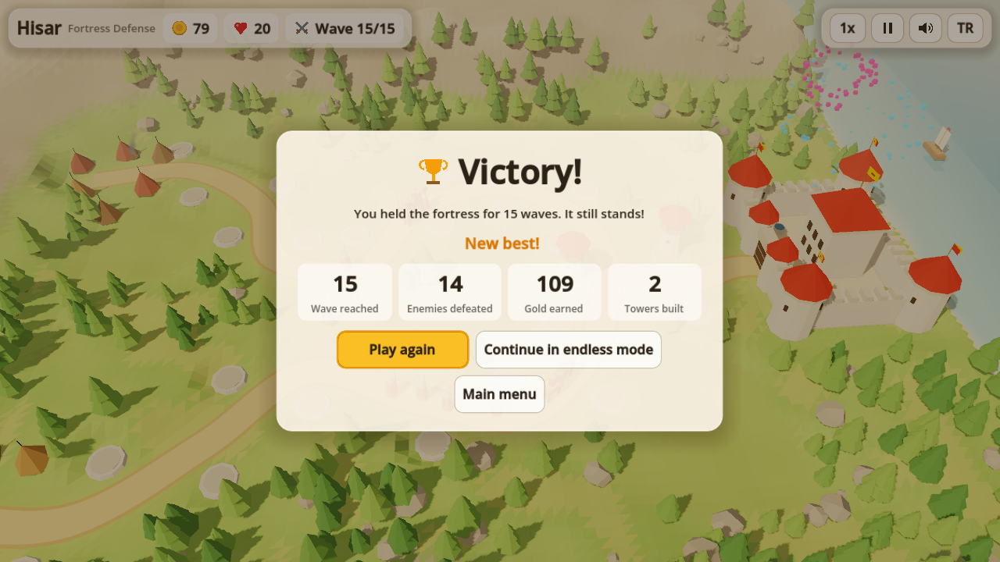
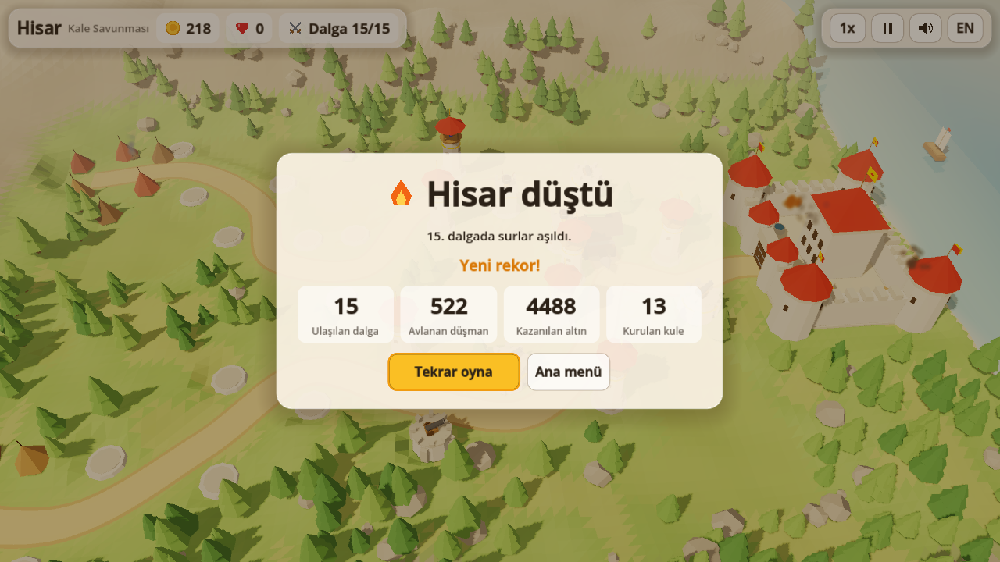
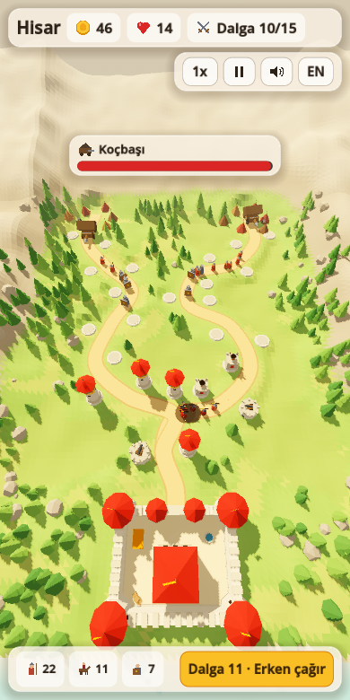

# 🏰 Hisar · Fortress Defense (Godot 4)

**[▶ Play in your browser](https://furkiozknn.github.io/hisar-godot/)** · Türkçe & English · desktop & mobile · free, no install

🏟️ Part of **[Claude Game Arena](https://github.com/Furkiozknn/claude-game-arena)**, round 2: every model remakes its own
round-1 browser game in Godot 4. This one was rebuilt by **Claude Opus 5.5** from its Three.js original,
[Hisar (kale-savunmasi)](https://github.com/Furkiozknn/kale-savunmasi). [See all games and the scorecard →](https://furkiozknn.github.io/claude-game-arena/)

A low-poly 3D tower defense: an enemy army marches on a seaside fortress along two roads.
Build towers on the stone pads, upgrade them and hold the fortress for 15 waves.
Same rules, numbers, names and Turkish / English text as round 1, rebuilt with a real engine.



| | |
|---|---|
|  |  |
|  |  |
|  |  |

<p align="center"></p>

## Features

- 3D battlefield built in code: flat-shaded terrain, animated sea shader, two roads, fortress,
  forest, enemy camps with smoke, boats and banners (AnimationPlayer).
- Three towers with three levels each (Archer Tower, Cannon Bastion, Tar Cauldron) and four
  enemies (Raider, Rider, Shieldbearer, Battering ram boss), all in `data/*.tres`.
- Target modes (first / strongest / nearest), early wave calls with bonus gold, endless mode.
- Juice: particle bursts, falling enemies, floating gold text, camera shake, damage vignette,
  pop-in tweens, boss health bar, fireworks on victory.
- Menus with transitions: title, pause, settings (master / music / effects volume, language,
  graphics quality, fullscreen) and end screen. Responsive layout down to 390x780 portrait.
- Synthesised music (9/8 aksak rhythm in the Hicaz mode) and sound effects, no audio files.
- Save system in `user://`: best wave, settings, and the run in progress (continue from the title).
- Keyboard, mouse, touch (pan, pinch, twist) and gamepad, all through the Input Map.

## Controls

| Action | Keyboard / mouse | Gamepad |
| --- | --- | --- |
| Select / build | Left click | A (pad nearest the camera focus) |
| Pan / rotate / zoom | Drag, arrows / right-drag, Q E / wheel, + - | Left stick / right stick / triggers |
| Next / previous pad | Tab / Shift+Tab | RB / LB |
| Build tower 1 2 3 | 1 2 3 | D-pad left / up / right |
| Upgrade / sell / target mode | U / S / T | X / - / D-pad down |
| Start wave / speed / pause | Space / F / P or Esc | Y / Back / Start |
| Language | L | |

## Running and testing

Godot 4.7 standard, Compatibility renderer. Main scene: `res://scenes/main.tscn`.

```sh
godot_console --headless --path . --import
godot_console --headless --path . --scene res://tests/run_tests.tscn   # prints TESTS PASSED n/n
godot_console --path . -- --auto                                        # the bot plays the game
```

User arguments (after `--`): `--auto` (bot plays), `--speed=N`, `--sim=SECONDS` (fast-forward the
battle), `--shot=title|settings|build|tower|pause|win|lose`, `--cam=close|fort|camp|top`,
`--lang=en`, `--low`, `--quit-on-end`, `--no-save`.
`GameState.get_state_text()` returns the current state as JSON.

The Web export preset is named `Web` and writes `build/web/index.html` (no threads).

## How it was made

Round 2 of a series in which **every game is built by a different AI model**. Each model gets the same brief,
[`prompts/godot-remake.md`](https://github.com/Furkiozknn/claude-game-arena/blob/main/prompts/godot-remake.md):
remake your own round-1 game in Godot 4.7 (GDScript, Compatibility renderer) and make it better, not just equal.
This one was built by **Claude Opus 5.5** (`claude-opus-5-5`) with [Claude Code](https://claude.com/claude-code).
The orchestrating session re-ran the checks independently before release:

- `TESTS PASSED 276/276`, clean headless import (no errors or warnings).
- The `--auto` bot plays all 15 waves: `LOSS at wave 15/15, lives 0, kills 522` (the balance is unchanged from round 1,
  and the simple bot cannot hold the last battering ram).
- 60 FPS at 1280x720 on High quality on an Intel UHD 620 laptop GPU.

The web build is exported on GitHub's servers by [`.github/workflows/pages.yml`](.github/workflows/pages.yml)
(pinned, checksum-verified Godot 4.7.2 and export templates) and published to GitHub Pages.

## License

Code: [MIT](LICENSE). Everything (models, terrain, music, sound) is generated in code; no third-party assets.
